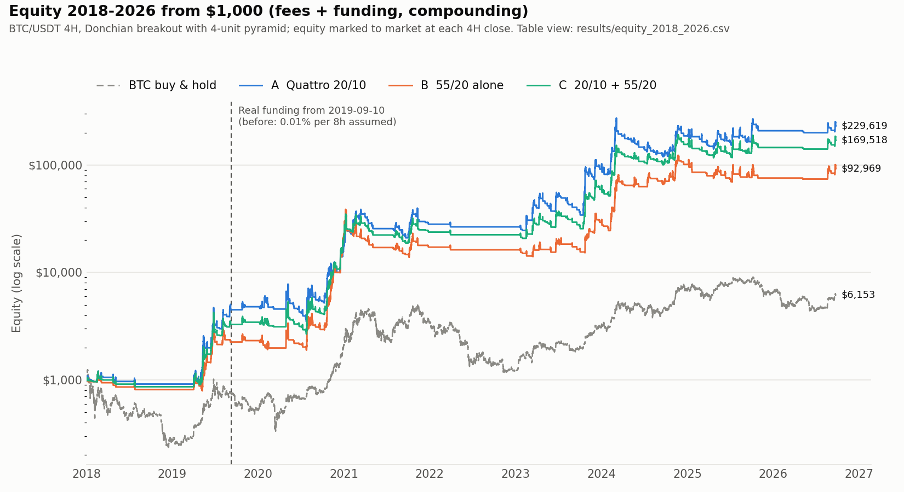
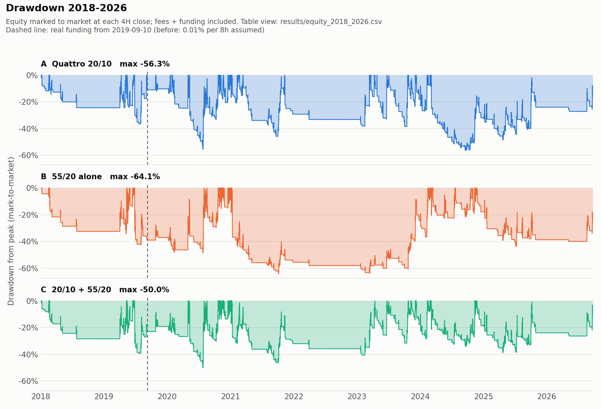

# Quattro — Donchian Breakout with 4-Unit Pyramid

**Status:** 🟢 Live on BloFin perpetual futures since May 2026

---

## 1. Hypothesis

Crypto markets exhibit persistent trends after volatility-expanded breakouts from prior highs. A pyramiding entry structure that adds size as the trend extends can capture asymmetric upside, provided risk is tightly managed at each addition and a hard catastrophe stop prevents disaster on failed breakouts.

This is the textbook **Donchian-Turtle-style trend follower** applied to BTC 4H, with a regime filter to avoid bear markets.

## 2. Strategy Specification

### Entry
- **Signal:** Close > previous 20-bar high (Donchian breakout)
- **Trend filter:** Daily 200 EMA must be rising (daily_EMA200[d] > daily_EMA200[d-20])
- **Execution:** Enter long at the next bar's open

### Pyramid Structure
- **Maximum units:** 4
- **Add levels:** Unit 2 at +0.5N, Unit 3 at +1.0N, Unit 4 at +1.5N (where N = ATR(14) at original entry, fixed for the entire sequence)
- **Each unit risks:** 2% of account at original entry, sized off 2N stop distance

### Exit Logic (three independent mechanisms)
- **Donchian channel exit:** close < previous 10-bar low → close ALL units at next bar's open
- **Per-unit trailing stop:** stop = newest unit's entry − 2N (wick-based). Tightens only when a new unit is added, not continuously as price moves.
- **Hard catastrophe stop:** combined unrealized loss reaches 5% of account (wick-based)
- **No fixed profit target** — the Donchian channel and the unit-based trail do the work

In live results, the three exit reasons split roughly: 40% hard stops, 36% Donchian exits, 23% trailing stops.

### Other Rules
- Single asset (BTC) — no multi-asset complexity
- 4H timeframe — strikes a balance between signal frequency and fee drag
- No shorting — long-only

## 3. Backtest Results

### Headline

| Metric | Value |
|---|---|
| Period | Jan 2022 – May 2026 (~4.1 years of live signals; first entry Mar 28, 2022) |
| Starting capital | $1,839 |
| Final account | $22,196 |
| Total return | **+1,107%** |
| APY | **+83%** |
| Max drawdown | **-37.5%** |
| Total trades | 94 (pyramid sequences, each may contain up to 4 unit entries) |
| Avg trade duration | 3.2 days |

### Trade Distribution

| Metric | Value |
|---|---|
| Wins | 25 (**26.6%**) |
| Losses | 69 (73.4%) |
| Average winner | **+13.4R** |
| Average loser | -2.0R |
| Win/loss asymmetry | **6.7x** |
| Best trade | +76.7R |
| Worst trade | -2.5R (capped by 5% catastrophe stop) |

### R-Distribution

| R Bucket | Count | % of trades |
|---|---|---|
| Loss > -1R (mostly -2.5R catastrophe stops) | 59 | 63% |
| Loss -1R to 0R | 10 | 11% |
| Win 0 to 5R | 10 | 11% |
| Win 5R to 10R | 4 | 4% |
| **Win > 10R (the trend-capture moonshots)** | **11** | **12%** |

This is a textbook trend-follower profile: **low win rate, occasional massive winners, many small-to-medium losses, capped catastrophic risk.** The 11 trades that returned >10R generate the bulk of the lifetime P&L. The strategy works because the asymmetry math overwhelms the win-rate math.

### Trades by Year

| Year | Trades |
|---|---|
| 2022 (partial, from March) | 1 |
| 2023 | 30 |
| 2024 | 32 |
| 2025 | 29 |
| 2026 YTD (through May) | 2 |

### Exit Reason Breakdown

| Exit Reason | Count | % |
|---|---|---|
| Hard 5% catastrophe stop | 38 | 40% |
| Donchian channel exit (close < 20-bar low) | 34 | 36% |
| 2x ATR trailing stop | 22 | 23% |

Note: the high count of catastrophe stops (40%) is expected for a pyramiding breakout strategy. Most breakouts fail. The catastrophe stop is the *floor*, not the average — the average loser is only -2.0R because many pyramid sequences exit before reaching the 5% combined-position floor.

## 4. Walk-Forward Validation

The strategy was tested on a split walk-forward:
- **Period 1 training (2022-2023):** edge confirmed across the 2022 bear and 2023 recovery
- **Period 2 fresh exam (2024-2026):** edge held — 32 trades in 2024, 29 in 2025, continuing positive expectancy

Both halves produced positive expectancy and were structurally similar in trade frequency (~30 per year). The strategy's edge is not concentrated in a single bull regime.

## 5. Operational Specification

The live deployment includes operational safety features built around the strategy logic:

- **Startup safety check** — bot refuses to start with stale state or pending positions
- **Auto-recovery** — systemd restarts on crash with state reload from the trade log
- **Daily heartbeat** — confirms the bot is alive even when no trades fire
- **Reconciliation** — exchange state checked against local state every hour
- **Margin pre-check** — refuses entries that would exceed available margin
- **Telegram alerts** — all entries, exits, and reconciliation events broadcast in real time

## 6. Capital Allocation

- **Account size:** $1,841 USDT total
- **Trading allocation:** $800 (4-unit pyramid worst-case margin)
- **Buffer:** ~$200 (margin safety)
- **Earn buffer:** $1,041 in BloFin Earn (tiered yield)

The trading allocation is intentionally less than the account total because the pyramid can scale aggressively under favorable conditions, and the strategy has been observed to consume 60-70% of available margin in deep extensions.

## 7. Files

- [`backtest.py`](backtest.py) — full research backtest script (CCXT-based, no API keys; reproducible from Binance public OHLCV)
- [`results/quattro_equity_curve.png`](results/quattro_equity_curve.png) — equity curve over the 4.1-year backtest

> **Note:** The live production code (with API keys, exchange credentials, and systemd service files) is intentionally **not** included in this public repository. Only research code is published.

## 8. Realistic Forward Expectation

- **Forward APY:** 30-60% (notably lower than the +83% backtest headline; reflects honest expectation under live conditions including slippage, funding, and execution delay)
- **Forward max DD:** 35-50% (consistent with or slightly worse than backtest)
- **Trade frequency:** ~25-35 sequences per year (~one every 10-14 days on average)
- **Psychological note:** the 26.6% win rate means **you will lose ~3 of every 4 trades**. Sitting through this requires faith in the asymmetry math, not in any single trade outcome.

## 9. Break-even variants (tested, rejected)

Script: [`backtest_breakeven_variants.py`](backtest_breakeven_variants.py) → [`results/breakeven_variants.csv`](results/breakeven_variants.csv). Same data and period (Jan 2022 – May 2026), same rules; only the stop changes:

- **A** Baseline — current system
- **B** Break-even when Unit 4 fills: `common_stop = max(common_stop, weighted avg entry)`
- **C** Break-even once close > weighted avg entry + 1N (N = ATR at original entry)
- **D** Same as C, plus the Donchian exit uses the 5-bar low (instead of 10) once Unit 4 is in

"Given back" = trades whose bar high exceeded weighted avg entry + 1N and still closed negative. 0R exits are counted separately (not wins, not in avg loss). Max DD on closed-trade equity; no fees.

**Full period (Jan 2022 – May 2026)**

| Variant | Return | APY | Max DD | Trades | Win rate | Avg win R | Avg loss R | 0R exits | Given back |
|---|---|---|---|---|---|---|---|---|---|
| A Baseline | **+1,107%** | **78.5%** | −37.5% | 94 | 26.6% | +13.42 | −2.01 | 0 | 25 |
| B BE @ Unit 4 | +875% | 69.9% | −37.7% | 112 | 14.3% | +17.22 | −1.78 | 41 | 5 |
| C BE @ +1N | +564% | 55.3% | −47.7% | 104 | 16.3% | +17.17 | −1.94 | 20 | 16 |
| D BE @ +1N + Donchian 5 | +476% | 50.3% | −44.7% | 107 | 18.7% | +14.13 | −1.90 | 18 | 16 |

**Walk-forward** (single run split by entry date; P2 measured from the equity P1 ended with)

| Period · Variant | Return | APY | Max DD | Trades | Win rate | Avg win R | Avg loss R | 0R exits | Given back |
|---|---|---|---|---|---|---|---|---|---|
| P1 2022-23 · A | +288% | 105.3% | −30.8% | 31 | 22.6% | +22.99 | −2.11 | 0 | 8 |
| P1 2022-23 · B | **+352%** | **122.6%** | **−22.2%** | 33 | 18.2% | +24.93 | −1.89 | 9 | 2 |
| P1 2022-23 · C | +302% | 109.3% | −27.2% | 31 | 19.4% | +26.25 | −2.07 | 3 | 6 |
| P1 2022-23 · D | +295% | 107.2% | −28.6% | 32 | 18.8% | +26.78 | −2.02 | 3 | 6 |
| P2 2024-26 · A | **+211%** | **60.0%** | −37.5% | 63 | 28.6% | +9.70 | −1.95 | 0 | 17 |
| P2 2024-26 · B | +116% | 37.5% | −37.7% | 79 | 12.7% | +12.60 | −1.73 | 32 | 3 |
| P2 2024-26 · C | +65% | 23.1% | −47.7% | 73 | 15.1% | +12.21 | −1.87 | 17 | 10 |
| P2 2024-26 · D | +46% | 17.0% | −44.7% | 75 | 18.7% | +8.70 | −1.84 | 15 | 10 |

**Why rejected**

- Break-even does cut given-back trades (25 → 5 in B, 16 in C/D), but win rate drops from 26.6% to 14–19%: many trends revisit the average entry before continuing, get stopped at 0R and are re-entered at a worse price.
- Every variant beats the baseline in P1 but loses in P2 (B +116%, C +65%, D +46% vs +211%): the improvement does not hold out of sample.
- C and D also deepen max drawdown to −45%/−48%, and B trades 19% more often, which fees would punish further.

> Sensitivity: `--realistic-fills` (the higher stop is hit first; fill at min(open, stop)) → [`results/breakeven_variants_realistic_fills.csv`](results/breakeven_variants_realistic_fills.csv). The baseline improves too (+1,274%); B edges it on the full period (+1,403%) but still loses in P2 (+188% vs +228%), so the verdict stands.

## 10. Baseline v2 (costos reales)

[`backtest_quattro_v2_costs.py`](backtest_quattro_v2_costs.py) runs the same system as `backtest.py` (same data and period) and adds a 0.06% taker fee on every fill (entry, each pyramid unit, exit) plus perpetual funding charged at each 00/08/16 UTC settlement on the open notional (positive funding costs the long). Fees and funding are debited from the balance when they occur, and that balance sizes the next units and trades; `--no-costs` reproduces the original trade by trade (94 trades, $22,196). Funding history comes from the Binance BTC/USDT:USDT perpetual ([`1_data/btc_funding_binance.csv`](../../1_data/btc_funding_binance.csv)) as a proxy for BloFin, which does not publish a long history. With costs, the 94 trades and the 26.6% win rate are unchanged, but total return falls from +1,107% to **+610%** (APY 78.5% → **57.8%**), max drawdown deepens from −37.5% to **−41.7%** and Calmar drops from 2.09 to **1.39**. Costs split almost evenly: $2,428 in fees (15.4R) vs $2,154 in funding (14.4R). The hit is larger in P2 2024-26 (APY 60.0% → 38.2%, Calmar 1.60 → 0.92) than in P1 2022-23 (APY 105.3% → 87.0%): costs are ~0.32R per trade in both halves, but P2 has twice the trades and a thinner edge per trade (avg win 9.7R vs 23.0R). The ten largest winners paid 0.3–2.9R each in funding (at most 9.7% of their gross P&L, in Feb–Mar 2024). Full table: [`results/quattro_v2_costs.csv`](results/quattro_v2_costs.csv); top-10 funding: [`results/quattro_v2_top10_funding.csv`](results/quattro_v2_top10_funding.csv). Slippage is still not modeled.

## 11. Round 2 (v2 engine)

All Round 2 experiments run on [`quattro_v2_engine.py`](quattro_v2_engine.py), a parametrized copy of the v2 logic (taker 0.06% + Binance funding debited from the balance) that verifies on every run that it reproduces v2 exactly, and are compared against **v2, not the original**. Acceptance criteria were fixed in advance: **(a)** Calmar better than v2 in P1 2022-23 **and** in P2 2024-26, **(b)** at least 70% of v2's trades, **(c)** a one-sentence economic rationale. Failing any one means rejected.

**Experiment 1 — no entries on Sunday-close signal bars** ([`backtest_v2_no_sunday.py`](backtest_v2_no_sunday.py), [`results/round2_no_sunday.csv`](results/round2_no_sunday.csv)). Variant 1a skips a new trade when the signal bar closes on Sunday UTC; variant 1b also defers pyramid units on Sunday-close bars (filled on the next allowed bar at max(trigger, open)). Only 8 of v2's 94 entries have a Sunday signal, and in 6 of them the breakout still holds on Monday, so the filter mostly delays the entry by a bar or two (92 trades, 98% of v2). Full-period return edges up (+618% / +614% vs +610%), but max drawdown deepens from −41.7% to −43.3%. Calmar improves in P1 (2.69 vs 2.60) and worsens in P2 (0.86 / 0.85 vs 0.92), so **1a and 1b are both REJECTED on criterion (a)**; (b) and (c) pass (Sunday-close breakouts form in the week's thinnest liquidity, with CME, ETFs and most desks closed). Caveat: the Sunday idea came from the 2019-2026 breakout study, so P1/P2 were not out-of-sample for this hypothesis.

**Experiment 2 — pyramid cap on extreme funding** ([`backtest_v2_funding_cap.py`](backtest_v2_funding_cap.py), [`results/round2_funding_cap.csv`](results/round2_funding_cap.csv)). Before adding a capped unit, the last settled 8h funding rate is compared with its rolling percentile over the previous 365 days (current settlement excluded, no look-ahead); above it, the unit and any later unit are not added for that trade. Four variants: p90 or p95, on unit 4 only or on units 3 and 4. The cap is rare: the rolling p90 often sits exactly at Binance's 0.01% baseline, so only 3–5% of settlements are above it, and none of P1's 36 unit-3/4 additions happened above it. P1 is therefore identical to v2, and all activations fall in 2024 (3–5 trades, 3–9 units not added). The blocked units would have paid $136–315 of funding, and most capped trades were losers anyway (the cap trims 0.1–0.9R off each loss). But one of them is the +26.5R winner of 26 Feb 2024, which falls to +20.3R (unit-4 cap) or +13.8R (units 3+4), and that single trade outweighs all the savings: full-period return drops to +506–556% (v2 +610%) and P2 Calmar to 0.72–0.81 (v2 0.92). **All four variants (2a–2d) are REJECTED on criterion (a)**: P1 Calmar is equal, not better, and P2 is worse. (b) passes (100% of trades) and so does (c): extreme positive funding marks crowded leveraged longs, raising squeeze risk and carry cost when the pyramid adds its largest exposure.

**Experiment 3 — three-speed ensemble** ([`backtest_v2_ensemble.py`](backtest_v2_ensemble.py), [`results/round2_ensemble.csv`](results/round2_ensemble.csv)). Three v2 subsystems (Donchian entry/exit 10/5, 20/10 and 55/20, each with pyramid, stops and the EMA-200 filter) share one balance at RISK_PCT/3 per unit each. Each subsystem's hard stop is scaled to 5%/3 so it stays at 2.5R, the leverage cap applies to combined notional, and costs are charged per subsystem order. Because positions overlap, P1/P2 split the closed-trade equity curve by exit date for every configuration, v2 included; v2's Calmar is identical under either split (2.60 / 0.92).

- **Full ensemble (REJECTED).** +483% vs +610%, max DD −34.5% vs −41.7%, Calmar 1.47 vs 1.39. It wins P2 (1.18 vs 0.92) but loses P1 (2.26 vs 2.60), so it fails (a).
- **Each speed alone at full risk (both REJECTED).** 10/5 fails (a) in both halves (Calmar 1.31 / 0.69). 55/20 fails (a) in P1 (1.88) and (b) with 54 trades (57% of v2).
- **Leave-one-out.** Without 20/10 and without 55/20, both are REJECTED on (a). **20/10 + 55/20 (without 10/5) is ACCEPTED**: Calmar 2.73 / 1.43 vs 2.60 / 0.92, 148 trades, return +299% at −23.4% DD. This also holds with total risk equalized to v2: at 1/2 risk each it reaches Calmar 2.67 / 1.30 and +493% at −33.2% DD, while v2 at the same 2/3 risk only reaches 2.65 / 0.99.
- **Does the ensemble depend on one speed?** Not for P&L: net profit splits 34% / 34% / 32% across 10/5, 20/10 and 55/20. But the P2 edge over v2 does depend on the **55/20** speed: without it, P2 Calmar is 0.91 (below v2), and the 10/5 speed dilutes the result (removing it improves Calmar in both halves).

Caveats: the accepted configuration came out of a post-hoc leave-one-out, not a pre-registered hypothesis, and was the only acceptance among 12 Round 2 variants. Its P1 margin is thin (+0.07 to +0.13 Calmar), and max DD is measured on closed-trade equity.

## 12. Round 3 (validación fuera de muestra)

Validation of **20/10 + 55/20** (each leg at 1/2 risk, so total risk equals v2's; hard stop scaled to keep 2.5R) against v2 (20/10 alone, full risk), both with taker fees and Binance funding. Script: [`backtest_round3_validation.py`](backtest_round3_validation.py) → [`results/round3_validation.csv`](results/round3_validation.csv). Criteria were fixed before running:

- **A:** beat v2 on Calmar in an unseen P0.
- **B:** at least 3 of 4 slow-leg neighbours beat v2 on P2 Calmar, and none falls below 0.5.
- **Verdict:** accepted only if both pass.

**P0 setup.** P0 = 2019-10-01 to 2021-12-31, an independent run from $1,839. Data comes from the 2019 4H cache (ATR warmed from 2019-01), the daily cache (EMA-200 warmed from 2017-08) and Binance funding from 2019-09-10. The 4H cache matches the live data bar for bar on 2022-01 to 2026-05. One 4H bar is missing in P0, and no funding settlement is.

**P1/P2 setup.** Same 2022-01 to 2026-05 run as Round 2, split by exit date.

**Test A — out of sample P0 (with costs)**

| Config | Period | Return | APY | Max DD | Calmar | Trades | Win rate | Avg win / loss R | Costs |
|---|---|---|---|---|---|---|---|---|---|
| v2 | **P0 2019-10 – 2021-12** | +525% | 125.6% | −40.0% | **3.14** | 58 | 25.9% | +15.62 / −2.13 | $4,213 |
| 20/10 + 55/20 | **P0 2019-10 – 2021-12** | +624% | 140.7% | −37.2% | **3.79** | 93 | 23.7% | +22.44 / −2.10 | $5,180 |
| v2 | 2020 (info) | +194% | 193.1% | −35.8% | 5.40 | 30 | 30.0% | +14.14 / −2.15 | $982 |
| 20/10 + 55/20 | 2020 (info) | +272% | 271.4% | −27.9% | 9.73 | 44 | 27.3% | +24.30 / −2.12 | $954 |
| v2 | 2021 (info) | +100% | 99.6% | −40.0% | 2.49 | 27 | 18.5% | +20.75 / −2.10 | $3,198 |
| 20/10 + 55/20 | 2021 (info) | +85% | 85.2% | −37.2% | 2.29 | 47 | 17.0% | +24.65 / −2.08 | $4,191 |

**Test B — parameter neighbourhood** (combos at 1/2 risk per leg; slow legs alone at full risk)

| Config | Calmar P0 | Calmar P1 | Calmar P2 | P0 return / DD / trades / costs | 2022-26 return / DD / trades / costs |
|---|---|---|---|---|---|
| v2 (20/10) | 3.14 | 2.60 | 0.92 | +525% / −40.0% / 58 / $4,213 | +610% / −41.7% / 94 / $4,583 |
| 20/10 + 40/15 | 3.50 | 2.68 | **1.48** | +558% / −37.3% / 100 / $4,195 | +761% / −34.6% / 156 / $4,874 |
| **20/10 + 55/20** | 3.79 | 2.67 | **1.30** | +624% / −37.2% / 93 / $5,180 | +493% / −33.2% / 148 / $3,498 |
| 20/10 + 70/25 | 3.98 | 2.88 | **1.41** | +584% / −33.9% / 88 / $4,886 | +532% / −32.9% / 143 / $3,494 |
| 20/10 + 100/30 | 4.13 | 2.56 | **1.49** | +594% / −33.0% / 80 / $4,582 | +453% / −30.3% / 138 / $2,909 |
| 40/15 alone | 3.26 | 3.02 | 1.76 | +535% / −39.0% / 42 / $3,927 | +838% / −34.7% / 62 / $4,904 |
| 55/20 alone | 3.40 | 1.88 | 1.31 | +664% / −43.1% / 35 / $6,355 | +330% / −35.9% / 54 / $2,473 |
| 70/25 alone | 3.94 | 1.91 | 1.73 | +602% / −34.9% / 30 / $5,753 | +382% / −31.0% / 49 / $2,469 |
| 100/30 alone | 4.28 | 0.48 | 1.81 | +615% / −32.6% / 22 / $5,087 | +244% / −31.4% / 44 / $1,601 |

**Verdict: 20/10 + 55/20 ACCEPTED.**

- **A passes:** P0 Calmar 3.79 vs 3.14.
- **B passes:** 4 of 4 combos beat v2's P2 Calmar of 0.92 (1.30–1.49), and none is below 0.5. 55/20 is not a lucky peak; it sits mid-pack among its neighbours.

Notes for reading the result (information, not part of the criteria):

- The P0 edge comes from 2020 (Calmar 9.73 vs 5.40). In 2021 alone the combination trailed v2 (2.29 vs 2.49).
- In P0 and P2, every slower leg also beats v2 on its own, so part of the gain is a general "add a slower channel" effect rather than something specific to 55/20.
- 20/10 + 40/15 scored higher than 55/20 in P1, P2 and 2022-26 return, but it was not the tested hypothesis.
- Max DD is on closed-trade equity. There is no slippage; fees and funding are modeled.

## 13. Backtest continuo 2018-2026 ($1,000)

One continuous run from **2018-01-01 to 2026-09-23**, starting with $1,000 and compounding, with real costs: taker 0.06% per side and Binance funding debited from the balance. It uses [`quattro_v2_engine.py`](quattro_v2_engine.py), which first re-verifies v2. Script: [`backtest_2018_2026.py`](backtest_2018_2026.py).

- **A** Quattro = 20/10 alone, full risk (2% per unit)
- **B** 55/20 alone, full risk
- **C** 20/10 + 55/20 at 1/2 risk per leg on a shared balance, as in Round 3

Max drawdown here is on **mark-to-market equity**: balance plus unrealized P&L of open units at every 4H close. This is stricter than the closed-trade DD used in earlier sections.

> **Funding before 2019-09-10 is assumed**, not real. The Binance BTC/USDT perpetual did not exist before 2019-09-10, so a flat 0.01% per 8h settlement is charged until then (dashed vertical line in the charts). Real Binance funding is used from 2019-09-10 on. With zero funding before that date instead, final balances would be about 5% higher (A $241,079, B $97,448, C $177,848).

**Summary 2018-01-01 → 2026-09-23**

| Config | Total return | Final balance | APY | Max DD (MTM) | Calmar | Trades | Win rate | Avg win / loss R | Total costs (fees + funding) |
|---|---|---|---|---|---|---|---|---|---|
| A Quattro 20/10 | +22,862% | $229,619 | 86.4% | −56.3% | 1.54 | 180 | 28.3% | +13.62 / −2.09 | $83,799 ($41,077 + $42,721) |
| B 55/20 alone | +9,197% | $92,969 | 68.1% | −64.1% | 1.06 | 107 | 27.1% | +19.78 / −2.17 | $32,542 ($11,477 + $21,065) |
| C 20/10 + 55/20 | +16,852% | $169,518 | 80.1% | **−50.0%** | **1.60** | 287 | 27.9% | +15.86 / −2.12 | $57,150 ($24,789 + $32,361) |
| BTC buy & hold | +515% | $6,153 | 23.1% | −81.4% | 0.28 | — | — | — | — (no fees) |

On closed trades only, the max DDs would be −41.7% (A), −43.1% (B) and −37.2% (C). Marking open positions to market adds 13–21 points.

**Calendar years — return % / max DD % (mark-to-market)**

| Year | A Quattro 20/10 | B 55/20 alone | C 20/10 + 55/20 | BTC buy & hold |
|---|---|---|---|---|
| 2018 | −8.4% / −24.3% | −18.7% / −32.4% | −13.6% / −28.4% | −73.0% / −81.4% |
| 2019 | +424.1% / −36.4% | +185.8% / −42.5% | +298.6% / −39.3% | +94.3% / −52.6% |
| 2020 | +267.6% / −55.4% | +865.5% / −44.0% | +515.4% / −50.0% | +302.0% / −56.0% |
| 2021 | +59.4% / −45.7% | −23.3% / −64.1% | +12.1% / −46.2% | +59.8% / −54.1% |
| 2022 | −5.5% / −9.2% | −5.5% / −9.2% | −5.5% / −9.2% | −64.2% / −67.2% |
| 2023 | +244.4% / −38.4% | +79.9% / −27.4% | +163.5% / −31.6% | +155.6% / −21.2% |
| 2024 | +104.1% / −56.3% | +246.2% / −22.8% | +163.2% / −34.0% | +121.3% / −30.0% |
| 2025 | +11.6% / −34.8% | −25.3% / −38.1% | −6.6% / −33.5% | −6.3% / −34.4% |
| 2026 YTD | +10.2% / −17.4% | +22.9% / −16.8% | +16.5% / −14.2% | −3.7% / −40.0% |

In 2022 the only trade was the 28 Mar breakout, which was both a 20-bar and a 55-bar breakout with the same ATR, so all three configurations took the same trade in R terms and show identical numbers.

Data and caveats:

- **Data sources.** 4H candles come from [`1_data/btc_4h_2017_cache.pkl`](../../1_data/fetch_btc_4h_2017.py) (Binance from 2017-08-17; 16 bars missing, all in 2018–2020). Daily candles for the EMA-200 are fetched live.
- **EMA-200 warm-up.** Binance has no earlier history, so on 2018-01-01 the daily EMA-200 rests on only 137 daily closes (about 25% seed weight, under 5% by July 2018). The 2018 regime filter is therefore approximate.
- **Buy & hold** buys at the 2018-01-01 open with no fees.
- **Not modeled:** slippage and minimum order sizes.
- **Files.** [`results/backtest_2018_2026.csv`](results/backtest_2018_2026.csv) holds the summary and calendar years; [`results/equity_2018_2026.csv`](results/equity_2018_2026.csv) holds the daily equity of the three configurations plus buy & hold.
